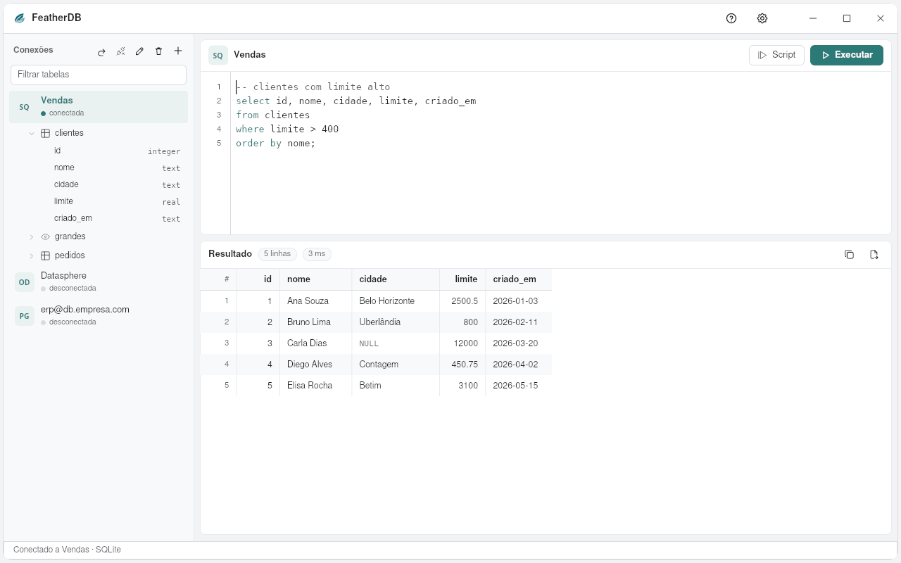

# FeatherDB

Cliente de bases de datos ligero de la suite [FeatherWorks](https://github.com/feather-works), en Rust con
[pelicano](https://github.com/feather-works/pelicano) y [feather-ui](https://github.com/feather-works/feather-ui).
La idea de DBeaver, sin el peso: abre al instante y usa unos 100 MB de memoria.

[English](README.md) · [Português](README.pt-BR.md)



## Qué hace

- **Conexiones:** PostgreSQL, MySQL/MariaDB y SQLite incluidos (TLS para bases en la nube). Pegue una
  dirección `postgresql://` o `mysql://` y el formulario se completa solo. Cualquier
  otra base por **ODBC**: SAP Datasphere/HANA, TIBCO TDV, SQL Server, Oracle, Snowflake… Cumple el papel
  de los drivers JDBC de DBeaver, sin Java. El administrador ODBC se carga solo al conectar: FeatherDB
  abre aunque unixODBC no esté instalado.
- **Editor SQL:** `Ctrl+Enter` ejecuta la sentencia del cursor (o la selección); `Alt+X`/`F5` ejecuta
  todo el script. Las consultas corren en segundo plano: la ventana nunca se congela.
- **Árbol de tablas:** tablas, vistas y columnas con su tipo; doble clic en una tabla muestra los datos.
  Un filtro encuentra la tabla en bases con miles de ellas.
- **Resultado:** hasta 1.000 filas, en páginas de 200; copiar todo para pegar en FeatherSheet o Excel,
  o exportar CSV.
- **Privado:** sin cuenta, sin telemetría. La contraseña nunca va al disco; las conexiones quedan en
  `~/.config/featherdb/conexoes.txt` (sin contraseña) y el texto del editor en `rascunho.sql`.
- Ayuda (F1), Configuración (tema, color de acento, idioma) y Novedades, en portugués, inglés y español.

## Compilar

```sh
cargo run --release
```

## Licencia

GPL-3.0.
