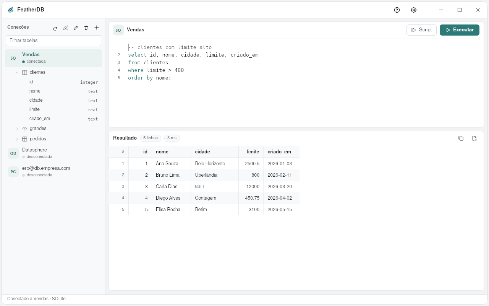

# FeatherDB

A lightweight database client from the [FeatherWorks](https://github.com/feather-works) suite, in Rust with
[pelicano](https://github.com/feather-works/pelicano) and [feather-ui](https://github.com/feather-works/feather-ui).
Think DBeaver, without the weight: it opens instantly and uses about 100 MB of RAM.

[Português](README.pt-BR.md) · [Español](README.es-ES.md)



## What it does

- **Connections:** PostgreSQL, MySQL/MariaDB and SQLite built in (TLS for cloud databases, with "encrypt only" for internal servers, a company CA and client certificates). Paste a
  `postgresql://` or `mysql://` address and the form fills itself in.
  **MongoDB** and Atlas (`mongodb+srv://`): collections in the tree, `find`, `aggregate` and
  `countDocuments` in the editor, documents as rows. Any other database through **ODBC**: SAP Datasphere/HANA, TIBCO TDV, SQL Server, Oracle, Snowflake…
  It plays the role of DBeaver's JDBC drivers, without Java. The ODBC manager is loaded only when you
  connect, so FeatherDB opens even if unixODBC is not installed.
- **SQL editor:** `Ctrl+Enter` runs the statement under the cursor (or the selection); `Alt+X`/`F5` runs
  the whole script. Queries run in the background, so the window never freezes, and **Stop** cancels them.
  Query tabs (`Ctrl+T`), each with its own SQL, connection and result; table and column names completed as you type;
  format the SQL (`Ctrl+Shift+F`); query plan (EXPLAIN); query history (`Ctrl+H`); open and save `.sql` files (`Ctrl+O`, `Ctrl+S`).
  Functions (PostgreSQL, MySQL) and materialized views in the tree, with REFRESH; templates for view, materialized view and function. A `DELETE` or `UPDATE` without
  `WHERE` asks before running. A dropped connection is reopened on its own.
- **Table tree:** with no database chosen, it lists the server's databases (like DBeaver); tables, views and columns with their types; double-click a table to see its data;
  right-click for SELECT, COUNT, copy the name, edit or delete.
  A filter finds tables in databases with thousands of them.
- **Table view:** Data, Structure and SQL (the `CREATE TABLE`) tabs; double-click a cell to edit the data
  (tables with a primary key; Save shows the `UPDATE`s and writes all or nothing); each column shows its type (with an icon per kind), whether it
  allows empty, its default and the key. Edit or add a column and see the SQL before it runs. Search tables
  and columns by name across open databases; export a table's columns or the whole database dictionary.
- **Results:** up to 1,000 rows that scroll lightly (only what is on screen is drawn); click a column to sort, filter the rows; copy everything to paste into FeatherSheet or Excel,
  or export CSV.
- **Private:** no account, no telemetry. Passwords go only to the system's password vault (GNOME Keyring/KWallet,
  Windows Credential Manager), never to a file; connections are kept in `~/.config/featherdb/conexoes.txt` the editor text in `rascunho.sql` and the history in `historico.txt`.
- Help (F1), Settings (theme, accent color, language) and What's new, in Portuguese, English and Spanish.

## Build

```sh
cargo run --release
```

## License

GPL-3.0.
