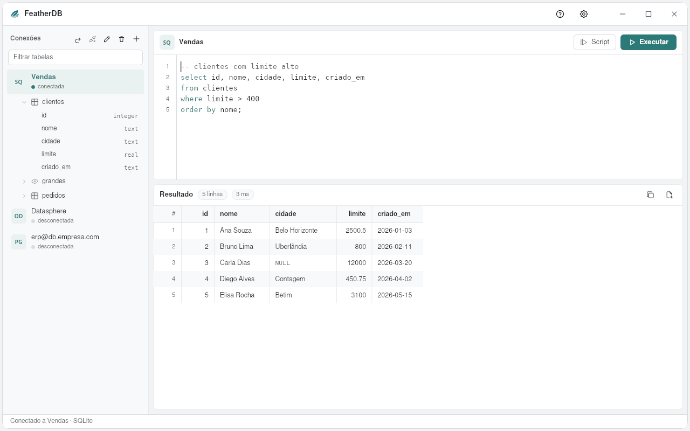

# FeatherDB

Cliente de banco de dados leve da suíte [FeatherWorks](https://github.com/feather-works), em Rust com o
[pelicano](https://github.com/feather-works/pelicano) e a [feather-ui](https://github.com/feather-works/feather-ui).
A ideia do DBeaver, sem o peso: abre na hora e usa cerca de 100 MB de memória.

[English](README.md) · [Español](README.es-ES.md)



## O que faz

- **Conexões:** PostgreSQL, MySQL/MariaDB e SQLite prontos (TLS para bancos na nuvem, com "só criptografar" para servidor interno, CA da empresa e certificado do cliente). Cole um endereço
  `postgresql://` ou `mysql://` e o formulário se preenche sozinho. Qualquer outro
  banco por **ODBC**. **MongoDB** e Atlas (`mongodb+srv://`): coleções na árvore, `find`, `aggregate` e
  `countDocuments` no editor, documentos como linhas: SAP Datasphere/HANA, TIBCO TDV, SQL Server, Oracle, Snowflake… É o papel dos
  drivers JDBC do DBeaver, sem Java. O gerenciador ODBC só é carregado ao conectar: o FeatherDB abre
  mesmo sem o unixODBC instalado.
- **Editor de SQL:** `Ctrl+Enter` roda o comando do cursor (ou a seleção); `Alt+X`/`F5` roda o script
  inteiro. As consultas rodam em segundo plano: a janela nunca trava, e **Parar** cancela.
  Abas de consulta (`Ctrl+T`), cada uma com o seu SQL, conexão e resultado; nomes de tabela e coluna completados ao
  digitar; formatar o SQL (`Ctrl+Shift+F`); plano da consulta (EXPLAIN); histórico (`Ctrl+H`). `DELETE` ou `UPDATE`
  sem `WHERE` pergunta antes de rodar. A conexão que caiu é refeita sozinha.
- **Árvore de tabelas:** sem banco escolhido, lista os bancos do servidor (como o DBeaver); tabelas, visões e colunas com o tipo; clique duplo numa tabela mostra os dados;
  o botão direito tem SELECT, COUNT, copiar o nome, editar e excluir.
  Um filtro acha a tabela em bancos com milhares delas.
- **Visão da tabela:** abas Dados, Estrutura e SQL (o `CREATE TABLE`); clique duplo numa célula edita os dados
  (tabela com chave primária; Salvar mostra os `UPDATE` e grava tudo ou nada); cada coluna mostra o tipo (com ícone por família), se aceita
  vazio, o padrão e a chave. Editar ou criar coluna mostrando o SQL antes de rodar. Busca de tabelas e colunas
  pelo nome nos bancos abertos; exportar as colunas de uma tabela ou o dicionário do banco inteiro.
- **Resultado:** até 1.000 linhas que rolam leve (só o que aparece na tela é desenhado); clique na coluna ordena, filtrar linhas; copiar tudo para colar no FeatherSheet ou no
  Excel, ou exportar CSV.
- **Privado:** sem conta, sem telemetria. A senha só vai para o cofre de senhas do sistema (GNOME Keyring/KWallet,
  Gerenciador de Credenciais do Windows), nunca para um arquivo; as conexões ficam em `~/.config/featherdb/conexoes.txt`, o texto do editor em `rascunho.sql` e o histórico em `historico.txt`.
- Ajuda (F1), Configurações (tema, cor de destaque, idioma) e Novidades, em português, inglês e espanhol.

## Compilar

```sh
cargo run --release
```

## Licença

GPL-3.0.
